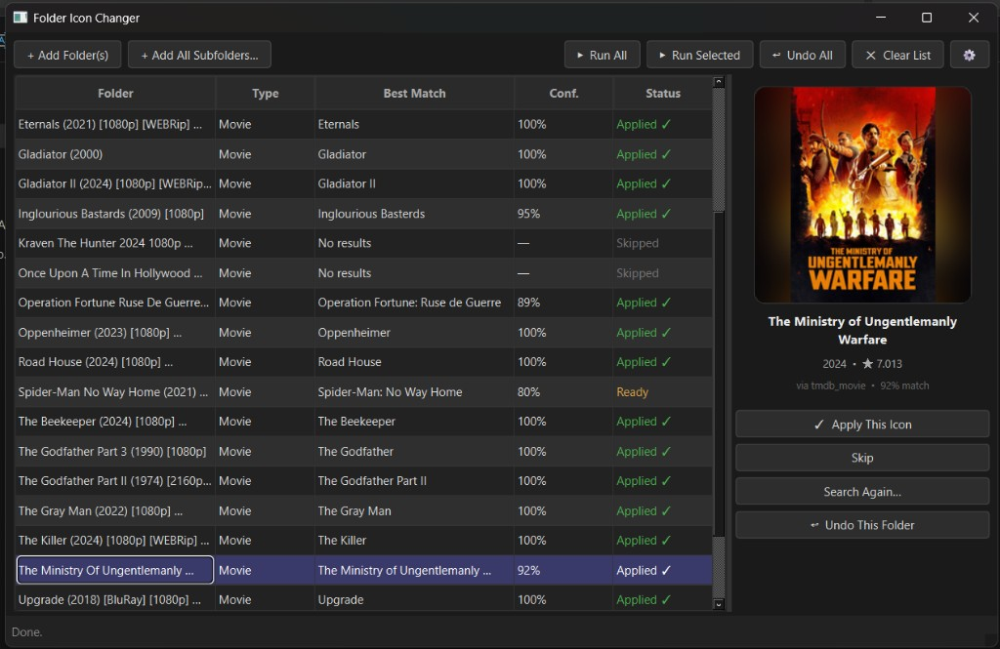
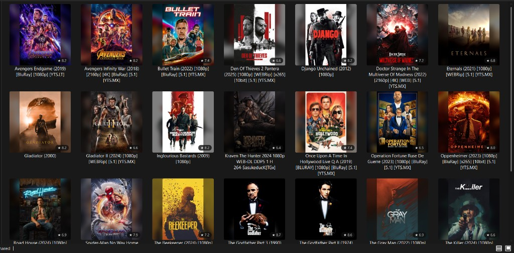

# Folder Icon Changer

A **Windows** desktop application that automatically sets custom folder icons pulled from real movie, TV show, game, and anime artwork. Drop in your media folders (or let the app first put loose movie files into folders of their own), click **Find Icons**, and every folder gets a polished poster icon — complete with optional rounded corners, a blurred backdrop, and a rating badge.

---

## Table of Contents

- [How It Works](#how-it-works)
- [Screenshots](#screenshots)
- [Requirements](#requirements)
- [Installation](#installation)
- [Running the App](#running-the-app)
- [Quickstart Workflow](#quickstart-workflow)
- [UI Reference](#ui-reference)
  - [Toolbar](#toolbar)
  - [Banners](#banners)
  - [Folder Table](#folder-table)
  - [Preview Panel](#preview-panel)
  - [Status Colors](#status-colors)
- [Settings](#settings)
  - [API Keys](#api-keys)
  - [Icon Style](#icon-style)
  - [Behavior](#behavior)
- [How Detection Works](#how-detection-works)
- [Search Sources](#search-sources)
- [Image Pipeline](#image-pipeline)
- [Icon Styles](#icon-styles)
- [Undo System](#undo-system)
- [Data & File Locations](#data--file-locations)
- [Caching](#caching)
- [Tech Stack](#tech-stack)
- [Project Structure](#project-structure)
- [Optional: Anime Upscaling (waifu2x)](#optional-anime-upscaling-waifu2x)
- [Troubleshooting](#troubleshooting)
- [License](#license)

---

## How It Works

```
Folder name
    │
    ▼
[Detector]  ──── regex pattern matching ────►  Content type (Movie / TV / Anime / Game)
    │                                           + clean title ("Oppenheimer (2023) [1080p]" → "Oppenheimer")
    ▼
[Searcher]  ──── TMDB / IGDB / AniList / Jikan ──►  Top-5 fuzzy-matched results
    │
    ▼
[Image Pipeline]  ──── download poster → upscale? → compose style → save .ico
    │
    ▼
[Icon Applier]  ──── copy folder.ico + write desktop.ini → set Win32 file attributes → refresh Explorer
```

1. **Detect** — the folder name is scanned against regex patterns (release tags, year formats, subgroup brackets, scene group names, etc.) to classify the content as a Movie, TV Show, Anime, or Game.
2. **Clean** — noise such as `[BluRay]`, `(1080p)`, `x265`, and the year are stripped to produce a clean search query.
3. **Search** — the right API(s) are queried and results are ranked by fuzzy-string similarity to the cleaned title.
4. **Process** — the best match's poster is downloaded, optionally upscaled (anime), fitted to a square canvas with a blurred background, styled, and saved as a multi-resolution `.ico`.
5. **Apply** — `folder.ico` is copied inside the target folder and a `desktop.ini` is written pointing Windows Explorer to it. The folder is flagged as a "system" folder so Explorer shows the custom icon.

---

## Screenshots

**App UI — folder list after a batch run, with the preview panel showing the selected match:**



**Result in Windows Explorer — folders with custom poster icons applied:**



---

## Requirements

| Requirement | Details |
|---|---|
| **OS** | Windows 10 or Windows 11 only. The icon mechanism (`desktop.ini` + Win32 file-attribute flags + `SHChangeNotify`) is Windows-exclusive. |
| **Python** | 3.10 or newer (3.12 / 3.13 recommended). |
| **Internet** | Required at runtime to query APIs and download artwork. |
| **Admin rights** | **Recommended** (not strictly required). When the app is not elevated, a dismissible **amber banner** at the top of the window explains that icon changes may fail on protected folders and offers **Restart as Administrator** (if you decline the UAC prompt the app simply stays open). Applying icons without elevation can fail on protected paths; error messages may suggest trying Administrator (see [Troubleshooting](#troubleshooting)). |

---

## Installation

```powershell
# 1. Clone or download the repository
git clone https://github.com/your-user/folder-icon-changer.git
cd "folder-icon-changer"

# 2. Create a virtual environment (strongly recommended)
python -m venv .venv
.venv\Scripts\activate

# 3. Install dependencies
pip install -r requirements.txt
```

**`requirements.txt` pinned minimums:**

| Package | Version | Purpose |
|---|---|---|
| `PyQt6` | ≥ 6.7 | Desktop GUI framework |
| `requests` | ≥ 2.32 | HTTP downloads (posters, API calls) |
| `rapidfuzz` | ≥ 3.9 | Fuzzy-string matching for title confidence |
| `Pillow` | ≥ 10.4 | Image compositing and `.ico` building |
| `diskcache` | ≥ 5.6 | Persistent disk-based API + image cache |
| `keyring` | ≥ 25 | Secure OS-keyring storage for API keys |

---

## Running the App

From the project root (with your virtualenv active):

```powershell
python -m app.main
```

**Alternative (Windows):** run `launch.bat` from the repository root. It checks for Python 3.10+, can create a `.venv`, install dependencies from `requirements.txt`, and may offer to install Python via `winget` if no suitable interpreter is found.

The window opens immediately. You do not need to configure anything for anime (AniList requires no key). For movies and TV shows you should add a TMDB key first (see [API Keys](#api-keys)).

---

## Quickstart Workflow

1. Open the app (`python -m app.main` or `launch.bat`). If an amber banner says you are not running as Administrator, use **Restart as Administrator** for the fewest permission issues.
2. Click **⚙ Settings** → **API Keys** → enter your TMDB API key → **Save** (anime needs no key).
3. Add your folders: **Add Subfolders…** for a library such as `D:\Movies`, **Add Folders** for specific ones, or just **drag & drop** folders onto the window.
   - If movie files lie *directly* in that library (no folder of their own), the app offers to **organize** them first — see [Organize loose movies](#organize-loose-movies).
4. Click **▶ Find Icons** (`F5`). The app detects each folder's content type and searches the right database. Matches at or above the confidence threshold are applied automatically; the rest wait as **Ready to apply**.
5. Review: click a row to see the exact icon preview. Wrong title? Click another entry under **Other matches**, or **Search…** for a different title.
6. Click **✓ Apply All Ready** (or **Apply Icon** for the selected rows). Done.

---

## Organize loose movies

Windows folder icons can only be set on *folders*. If your library looks like this:

```
D:\Movies\Inception.2010.1080p.BluRay.x264-GROUP.mkv
D:\Movies\Inception.2010.1080p.BluRay.x264-GROUP.srt
D:\Movies\Heat.1995.720p.mkv
```

use **🎬 Organize Movies…** (`Ctrl+M`), or accept the offer shown when you add a library folder that contains loose movies. You get a **preview** of every move first:

- Each movie gets a folder named `Title (Year)` — `D:\Movies\Inception (2010)\`. Double-click a name to change it.
- Subtitles and `.nfo` files with the same name move along with the movie.
- TV episodes (`S01E02`) and sample clips are left alone.
- Nothing is overwritten or deleted. If a file with the same name already exists in the target folder, that movie is marked and not moved.
- With **Find and apply icons right after organizing** ticked (default), the new folders go straight through *Find Icons*.
- **⋯ → Undo Last Organize…** moves everything back (removing any icon we applied and the folders we created).

---

## UI Reference

The main window has a **minimum size** of **980×600** pixels. Its size and position, and the last folder you browsed, are remembered.

### Toolbar

| Button | Shortcut | Action |
|---|---|---|
| **＋ Add Folders** | `Ctrl+O` | Pick one or more folders (Ctrl/Shift-click to select several). |
| **Add Subfolders…** | `Ctrl+Shift+O` | Add every immediate subfolder of a library folder such as `Movies/` or `Anime/`. Offers to organize loose movie files first. |
| **🎬 Organize Movies…** | `Ctrl+M` | Give loose movie files their own folders ([details](#organize-loose-movies)). |
| **▶ Find Icons** | `F5` / `Ctrl+R` | Detect and search for every folder in the list (skipped and already-applied folders are left out). |
| **✓ Apply All Ready (N)** | | Apply every match that is waiting for your approval. |
| **⋯** | | *Undo All Icons…*, *Undo Last Organize…*, *Clear List*. |
| **⚙** | `Ctrl+,` | Open Settings. |

You can also **drag & drop** folders onto the window, and **right-click** rows for *Find icon, Apply, Search for another title, Skip, Undo, Open in Explorer, Remove from list*. `Delete` removes the selected rows from the list and `Enter` applies the selected rows.

### Banners

Below the toolbar, one or both **dismissible banners** may appear:

| Banner | When | Actions |
|---|---|---|
| **Administrator** (amber) | The app is not running elevated | Explains that icon changes may fail on protected folders. **Restart as Administrator** relaunches the app with elevation. |
| **API keys** (purple) | TMDB and/or IGDB credentials are missing | Explains that movie, TV, and game searches need keys. **Add API keys** opens Settings. Anime (AniList / Jikan) works without keys. |

If keys are missing for a content type, affected folders show **No match** with a status-bar hint. The **Search…** dialog shows its own **API key** banner with links to obtain credentials.

### Folder Table

An empty list shows a short welcome screen with the main actions. Once folders are added:

| Column | Description |
|---|---|
| **Folder** | Folder name (hover for the full path). |
| **Type** | Detected content type: `Movie`, `TV Show`, `Anime`, `Game`, or `Unknown`. |
| **Best match** | The title of the selected search result. |
| **Match %** | Fuzzy title-match confidence. Green = at/above the auto-apply threshold, amber = 60%+, orange = lower. |
| **Status** | Current processing state (see [Status Colors](#status-colors) below). |

The footer summarizes the list (*5 folders · 1 ready · 3 applied*). **Double-clicking** a row opens **Search…**.

### Details Panel

The right-hand panel shows the selected folder and:
- A **live preview of the real icon** — rendered with the same code and your current Icon Style settings as *Apply*.
- Title, year, rating, source and match confidence.
- **Other matches**: every candidate found; click one to switch (the row becomes *Ready to apply* again).
- Pinned action buttons: **Apply Icon** (applies to *all* selected rows when several are selected), **Search…**, **Skip**, **Open** (in Explorer) and **Undo Icon**.

### Status Colors

| Status | Color | Meaning |
|---|---|---|
| Pending | Grey | Folder added but not yet processed. |
| Searching… | Blue | Detection + API search in progress (background thread). |
| Ready to apply | Amber | A match was found below the auto-apply threshold (or you changed the match) — review it, then apply. |
| Applying… | Blue | Image pipeline running and icon being written. |
| Applied ✓ | Green | Icon successfully applied. |
| Failed ✗ | Red | Something went wrong (no image URL, write permission error, etc.). |
| No match | Orange | Nothing was found (or an API key is missing). Use **Search…** with another title. |
| Skipped | Dark grey | You pressed **Skip**; **Find Icons** ignores the folder until you select it again. |

---

## Settings

Open via the **⚙** button in the top-right corner of the toolbar. Settings are saved immediately on **Save** and persist across sessions in `%APPDATA%\FolderIconChanger\prefs.json`.

### API Keys

API keys are stored in the **Windows Credential Manager** (OS keyring), not in any plain-text file in the project directory.

| Field | Where to get it | Required for |
|---|---|---|
| **TMDB API Key** | [themoviedb.org/settings/api](https://www.themoviedb.org/settings/api) — free account required | Movies and TV shows |
| **IGDB Client ID** | [dev.twitch.tv/console](https://dev.twitch.tv/console) — create a Twitch application | Games |
| **IGDB Client Secret** | Same Twitch application page | Games |

The **API Keys** tab also includes a short note with **clickable links** to [themoviedb.org/settings/api](https://www.themoviedb.org/settings/api) (TMDB) and [dev.twitch.tv/console/apps](https://dev.twitch.tv/console/apps) (Twitch apps for IGDB credentials).

> **AniList** (anime) uses a public GraphQL API that requires no authentication. **Jikan** (MyAnimeList mirror) is used as a fallback, also with no key.

### Icon Style

| Setting | Type | Default | Description |
|---|---|---|---|
| **Icon style** | Dropdown | `Clean Poster` | Visual treatment applied to the poster. See [Icon Styles](#icon-styles). |
| **Rounded corners** | Checkbox | ✓ On | Apply rounded corners to the icon edges. |
| **Corner radius** | Spinner (0–64 px) | `12` | Pixel radius for the rounded corners. |
| **Show rating badge** | Checkbox | Off | Overlay a ★ score pill in the bottom-right corner. |
| **Icon resolution** | Spinner (128–256 px) | `256` | Size of the largest frame embedded in the `.ico` file. |

### Behavior

| Setting | Type | Default | Description |
|---|---|---|---|
| **AI upscale low-res anime images** | Checkbox | ✓ On | Use waifu2x to upscale small anime posters before compositing (requires waifu2x binary; falls back to LANCZOS). |
| **Auto-apply threshold** | Spinner (50–100%) | `85%` | When a search result's confidence is at or above this value, the icon is applied automatically without user intervention. |

The application uses a **fixed dark theme** for the entire UI; there is no light mode or theme toggle in Settings.

---

## How Detection Works

The **Detector** (`app/services/detector.py`) reads the raw folder name and scores it against four sets of regex patterns:

| Type | Pattern examples |
|---|---|
| **Anime** | `[SubGroup]` brackets, Japanese/Chinese Unicode characters, `OVA`/`ONA`/`Specials`, `Dubbed`/`Subbed`, `BDRip` |
| **Movie** | Year like `(2023)`, release tags `BluRay`/`WEBRip`/`WEB-DL`, edition keywords `Remastered`/`Extended`, resolutions `1080p`/`4K` |
| **TV Show** | `Season N`, `S01E02` / `S01` season-pack format, `Complete Series`, `Episode N` |
| **Game** | Scene group names (`CODEX`, `SKIDROW`, `FitGirl`, `EMPRESS`, `PLAZA`), `Steam`/`GOG`/`Epic Games`, version strings `v1.0`/`DLC`/`GOTY` |

The type with the most pattern hits wins. If the folder contains `.exe` or `.iso` files, the Game score gets a +2 bonus. If it contains more than 3 `.mkv` files, the Anime score gets +1.

After classification, the **title cleaner** strips all recognized noise tokens (brackets, resolutions, codecs, years, separators) to produce a clean title for the API search query.

---

## Search Sources

| Source | Content | Key required | Protocol |
|---|---|---|---|
| **TMDB** (The Movie Database) | Movies | Yes | REST |
| **TMDB** | TV Shows | Yes | REST |
| **AniList** | Anime | No | GraphQL |
| **Jikan** (MyAnimeList) | Anime (fallback) | No | REST |
| **IGDB** (Twitch) | Games | Yes (Client ID + Secret) | REST / OAuth2 |

All API responses are cached on disk for **24 hours** so repeated runs on the same folders don't make network requests.

When the detected type is `Unknown`, the app queries all four sources in parallel and returns the globally highest-confidence result.

**Fuzzy matching** uses `rapidfuzz.fuzz.token_sort_ratio`, which is insensitive to word order and handles partial-match cases (e.g. `"Inglourious Bastards"` matching `"Inglourious Basterds"` at 95%).

---

## Image Pipeline

The full pipeline (`app/services/image_pipeline.py`) for each icon:

1. **Download** — the poster URL is fetched with a 15-second timeout and saved to the disk image cache.
2. **Upscale (optional)** — if the image is smaller than 300 px wide and the content type is Anime, `waifu2x-ncnn-vulkan` is called with `scale=4` (images < 150 px) or `scale=2` using the CUNet model at noise level 2. Falls back to LANCZOS if waifu2x is not installed.
3. **Fit to square** — the poster is composited onto a blurred, darkened version of itself (the same "backdrop blur" technique used by Netflix and Apple Music):
   - **Background layer**: poster scaled to *cover* the square, centre-cropped, Gaussian-blurred (radius 18), and darkened to 50%.
   - **Foreground layer**: poster scaled to *contain* within the square, centred horizontally, and shifted 30% upward (so faces/titles remain prominent).
4. **Style decoration** — rounded corners, border frame, or glassmorphism overlay applied according to the selected icon style (see [Icon Styles](#icon-styles)).
5. **Rating badge (optional)** — a semi-transparent pill (`★ 8.7`) is drawn in the bottom-right corner using Segoe UI Symbol for proper star glyph rendering.
6. **Save multi-resolution `.ico`** — the composed image is downsampled and the following frames are embedded: `256×256`, `64×64`, `48×48`, `32×32`, `16×16`. Windows picks the right frame automatically depending on the view size.

---

## Icon Styles

| Style | Description |
|---|---|
| **Clean Poster** *(default)* | Poster on blurred background, rounded corners. Clean and modern. |
| **Framed** | Thin white border drawn around the poster edge. |
| **Glassmorphism** | Blurred, frosted glass border with a subtle white overlay ring. |
| **Rating Badge** | Same as Clean Poster but forces the ★ score badge regardless of the badge checkbox setting. |
| **Minimal** | Poster only — no rounded corners, no frame, no decoration. |

---

## Undo System

Before writing any file, the app records a **undo snapshot** in `%APPDATA%\FolderIconChanger\undo\<md5-of-path>.json` containing:
- Whether a `desktop.ini` existed before (and its full content if so).
- The original Win32 file attributes of the folder.

**Undo** reads this snapshot and:
1. Removes `folder.ico` and the new `desktop.ini`.
2. Restores the original `desktop.ini` (if one existed before the app ran).
3. Restores the original folder attributes.
4. Calls `SHChangeNotify` to tell Explorer to refresh.

This means running undo is truly non-destructive — folders with custom icons before the app ran get their original `desktop.ini` back.

---

## Data & File Locations

All app data is stored under `%APPDATA%\FolderIconChanger\` (e.g. `C:\Users\YourName\AppData\Roaming\FolderIconChanger\`).

| Path | Contents |
|---|---|
| `prefs.json` | Preferences saved from Settings (icon style, rounded corners, badge, resolution, upscale, auto-apply threshold). Older files may still contain a legacy `dark_mode` key, which is ignored. |
| `cache\` | `diskcache` directory for API responses and image file paths |
| `undo\` | Per-folder undo snapshots (`<md5>.json`) |

API keys are stored in the **Windows Credential Manager**, not in this directory.

---

## Caching

| Cache type | TTL | Key |
|---|---|---|
| API search results | 24 hours | `api:<source>:<md5(query)>` |
| Image files (local path) | 7 days | `img:<md5(url)>` |

Cached images are stored as `.png` files in the `cache\` directory. The cache is managed by `diskcache` and is safe to delete manually if you want to force a fresh fetch.

---

## Tech Stack

| Library | Version | Role |
|---|---|---|
| **PyQt6** | ≥ 6.7 | Desktop UI framework (widgets, threading, signals) |
| **Pillow** | ≥ 10.4 | Image download, compositing, `.ico` generation |
| **rapidfuzz** | ≥ 3.9 | Fuzzy title matching (`token_sort_ratio`) |
| **requests** | ≥ 2.32 | HTTP API calls and image downloads |
| **diskcache** | ≥ 5.6 | Persistent disk-based cache |
| **keyring** | ≥ 25 | Secure OS-keyring API key storage |
| **ctypes / Win32** | stdlib | `SetFileAttributesW`, `SHChangeNotify` |

---

## Project Structure

```
folder-icon-changer/
├── launch.bat                   # Windows launcher: Python check, venv, pip install, run app
├── app/
│   ├── main.py                  # Entry point — QApplication + MainWindow
│   ├── config.py                # Preferences (load/save prefs.json), API key keyring wrappers,
│   │                            #   cache_dir() and undo_dir() path helpers
│   ├── resources/               # Optional: icon.png (window icon when present)
│   ├── api/
│   │   ├── tmdb.py              # TMDB REST calls (search_movie, search_tv, poster_url, …)
│   │   ├── anilist.py           # AniList GraphQL search + best_image_url
│   │   ├── jikan.py             # Jikan (MyAnimeList) REST search, title helpers
│   │   └── igdb.py              # IGDB OAuth2 token + game search, cover_url
│   ├── services/
│   │   ├── detector.py          # Regex-based content-type detection + title cleaning
│   │   ├── searcher.py          # Orchestrates API calls → SearchResult list with fuzzy ranking
│   │   ├── image_pipeline.py    # Download → upscale → compose (render_icon) → build multi-res .ico
│   │   ├── organizer.py         # Loose movie files → "Title (Year)" folders, with logged undo
│   │   └── icon_applier.py      # Write folder.ico + desktop.ini, Win32 attrs, undo support
│   ├── ui/
│   │   ├── main_window.py       # MainWindow: toolbar, empty state, folder table, details panel, workers
│   │   ├── organize_dialog.py   # Preview-and-confirm dialog for organizing loose movies
│   │   ├── preview_widget.py    # Live preview of the real icon + metadata labels
│   │   ├── styles.py            # Dark theme (palette + stylesheet)
│   │   ├── widgets.py           # ElidedLabel
│   │   ├── search_dialog.py     # Manual search override dialog
│   │   └── settings_dialog.py   # 3-tab settings dialog with live icon-style preview
│   └── utils/
│       ├── admin.py             # is_admin() / relaunch_as_admin()
│       ├── cache.py             # diskcache wrappers (get/set, image path helpers)
│       ├── fuzzy.py             # clean_title() + best_match() using rapidfuzz
│       ├── threads.py           # Keeps QThread workers alive until finished (no terminate())
│       └── upscaler.py          # waifu2x-ncnn-vulkan wrapper with LANCZOS fallback
├── tests/                       # pytest suite (pip install -r requirements-dev.txt)
├── docs/
│   └── screenshots/             # README screenshots (e.g. app-ui.png, result-explorer.png)
├── requirements.txt
└── README.md
```

---

## Optional: Anime Upscaling (waifu2x)

For anime posters the source image is often small (150–300 px). The app can use `waifu2x-ncnn-vulkan` to upscale before compositing, producing sharper icons.

**Setup:**

1. Download a release from [github.com/nihui/waifu2x-ncnn-vulkan/releases](https://github.com/nihui/waifu2x-ncnn-vulkan/releases).
2. Extract to `resources/waifu2x-ncnn-vulkan/` inside the project root:
   ```
   resources/
   └── waifu2x-ncnn-vulkan/
       ├── waifu2x-ncnn-vulkan.exe
       └── models-cunet/
           └── ...
   ```
3. Enable **AI upscale low-res anime images** in Settings → Behavior (it is on by default).

If the binary is absent, the app automatically falls back to Pillow `LANCZOS` resampling — no configuration change needed.

---

## Troubleshooting

**Icons don't appear after applying**

- Press **F5** in Explorer or navigate away and back.
- If it still doesn't work, open a folder's Properties → Customize → Change Icon... and point to `folder.ico` manually once to force a cache refresh.
- On some systems you may need to clear the Windows icon cache:
  ```powershell
  ie4uinit.exe -show
  ```

**"Applied ✓" but the icon is still the default yellow folder**

- Ensure the folder is not on a network share or a drive with a file system that doesn't support NTFS alternate streams. The `desktop.ini` mechanism requires NTFS.
- Use the startup **Restart as Administrator** option, the **amber banner** in the main window, or relaunch the app as Administrator. Permission errors when applying an icon may say to try running as Administrator.

**Movies/TV shows return no results**

- Make sure your TMDB API key is entered in Settings → API Keys. Without it the app cannot query TMDB.

**Games return no results**

- You need both an IGDB Client ID **and** Client Secret. These come from a Twitch Developer application, not from IGDB directly. Visit [dev.twitch.tv/console](https://dev.twitch.tv/console).

**Slow first run**

- The first search for each folder hits the network. Subsequent runs for the same folder names are served from disk cache instantly.

**Low confidence matches / wrong title matched**

- Double-click the row (or click **Search…**) to open the manual search dialog. You can type a corrected query, change the content type, and pick from the result list.
- Lowering the **Auto-apply threshold** in Settings → Behavior (e.g. to 70%) will let more matches apply automatically, but increases the chance of incorrect icons.

---

## License

Add a license file if you distribute this project (e.g. MIT, GPL-3.0).
